<div align="center">

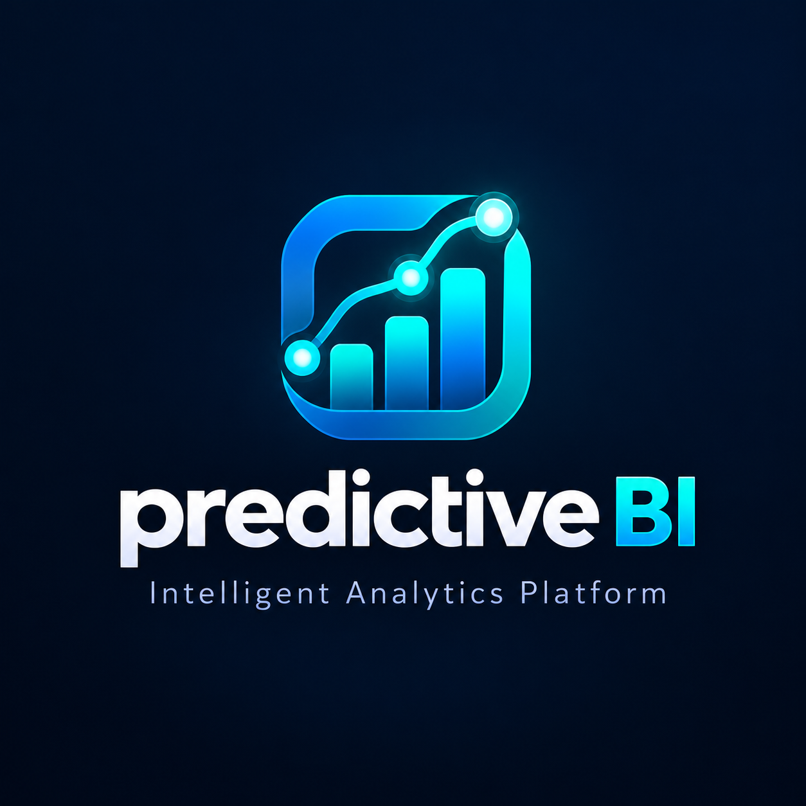

# Predictive BI

### Intelligent Analytics Platform · Backend em workflows n8n

**Dados → ETL auditável → indicadores → Machine Learning → evidências → dashboard**


Um laboratório de automação, engenharia de dados, analytics e IA aplicada, com cada etapa inspecionável no canvas do n8n.

</div>

---

## Demonstração em movimento

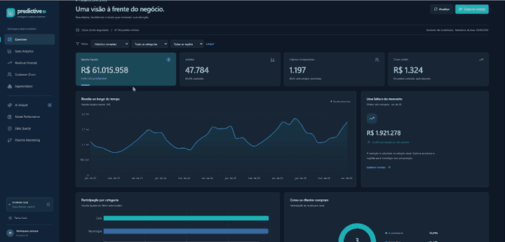

Gravação real do projeto, com dados demonstrativos. Os trechos abaixo foram extraídos do vídeo fornecido pelo autor; barras e favoritos do navegador foram removidos.

## Índice

1. [Proposta e funcionalidades](#proposta-e-funcionalidades)
2. [Arquitetura](#arquitetura)
3. [Tecnologias e responsabilidades](#tecnologias-e-responsabilidades)
4. [Origem dos dados](#origem-dos-dados)
5. [Modelagem e indicadores](#modelagem-e-indicadores)
6. [Instalação completa no Windows](#instalação-completa-no-windows)
7. [Importação e publicação no n8n](#importação-e-publicação-no-n8n)
8. [Os sete workflows explicados](#os-sete-workflows-explicados)
9. [Guia de análise do dashboard](#guia-de-análise-do-dashboard)
10. [Machine Learning e avaliação](#machine-learning-e-avaliação)
11. [Ollama e IA com evidências](#ollama-e-ia-com-evidências)
12. [Docker Compose e PostgreSQL](#docker-compose-e-postgresql)
13. [API e exemplos](#api-e-exemplos)
14. [Testes e verificações](#testes-e-verificações)
15. [Operação e problemas frequentes](#operação-e-problemas-frequentes)
16. [Organização do repositório](#organização-do-repositório)
17. [Vídeo, prints e identidade visual](#vídeo-prints-e-identidade-visual)
18. [Limites e próximos passos](#limites-e-próximos-passos)

## Proposta e funcionalidades

Predictive BI converte um histórico comercial fictício em uma aplicação analítica navegável. Permite acompanhar a origem do dado, sua validação, persistência, transformação em atributos, avaliação de modelos e apresentação em gráficos e interpretações verificáveis.

O **n8n é o backend visual**: recebe requisições do dashboard, valida entradas, executa regras comerciais em nós Code, encaminha tarefas especializadas e responde com JSON. O frontend é React. Python permanece como worker para banco, ETL e bibliotecas de Machine Learning. Não há uma instalação de scikit-learn dentro de um nó JavaScript.

| Área | Implementação |
| --- | --- |
| Dados | Gerador determinístico, manifesto, chaves consistentes e SHA-256 |
| Engenharia | ETL incremental, janela de sobreposição, hash por registro, upsert, transação e auditoria |
| Banco | Esquema dimensional em PostgreSQL; SQLite como modo degradado explícito |
| n8n | Quatro pipelines independentes, fluxo completo e dois backends HTTP |
| Previsão | Receita semanal, baseline sazonal, backtesting e oito semanas de horizonte |
| Churn | Regressão logística, Random Forest e XGBoost quando instalado |
| Segmentação | Recência, frequência e valor monetário com K-Means |
| Explicabilidade | SHAP com identificação do classificador explicado |
| Tracking | Métricas, parâmetros, hashes e artefatos; MLflow quando disponível |
| IA | Qwen via Ollama, resposta estruturada e fallback determinístico identificado |
| Interface | Nove páginas, tema claro/escuro, filtros, tabelas e gráficos diversos |
| Operação | Scripts PowerShell, Compose, testes e documentação |

**Todos os clientes, produtos e pedidos são sintéticos.** Não há dados corporativos, pessoais reais ou extraídos de um CRM. As métricas demonstram o funcionamento técnico nesse cenário; não validam desempenho em uma empresa.

## Arquitetura

### Consulta do dashboard

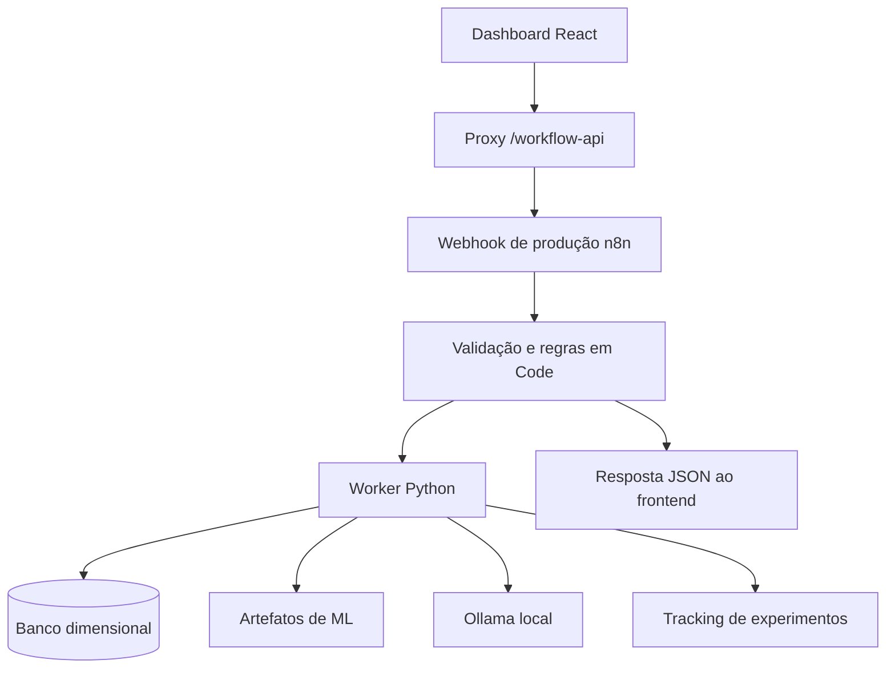

O proxy mantém a mesma origem do navegador e encaminha somente contratos conhecidos. No modo padrão, uma falha do n8n não é desviada silenciosamente para Python: a interface mostra a indisponibilidade.

O seletor **Backend** permite escolher **Python · direto**, para comparar implementações e diagnosticar o worker. Essa escolha fica no navegador e é identificada na interface. O modo padrão é **n8n · workflows**.

### Tarefas assíncronas

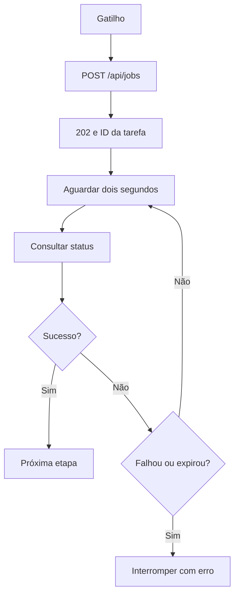

HTTP `202` significa aceitação, não conclusão. O n8n acompanha o ID até sucesso, falha ou expiração. O worker executa uma tarefa pesada por vez para evitar concorrência sobre dados e artefatos compartilhados.

### Portas e serviços

| Serviço | Nativo deste guia | Docker Compose |
| --- | --- | --- |
| Dashboard | `http://127.0.0.1:8101` | `http://127.0.0.1:5180` |
| OpenAPI | `http://127.0.0.1:8101/docs` | `http://127.0.0.1:8100/docs` |
| Healthcheck | `http://127.0.0.1:8101/health` | `http://127.0.0.1:8100/health` |
| n8n | `http://localhost:5678` | `http://localhost:5680` |
| MLflow, se iniciado | `http://127.0.0.1:5010` | `http://127.0.0.1:5010` |
| Ollama no host | `http://127.0.0.1:11434` | `host.docker.internal:11434` no worker |
| PostgreSQL | Conforme `.env`, exemplo `55432` | Host `55432` → container `5432` |

No modo nativo, FastAPI serve o build React na mesma porta. O Vite separado é opcional para desenvolvimento.

## Tecnologias e responsabilidades

| Tecnologia | Uso efetivo |
| --- | --- |
| Python 3.13 | Runtime da execução de referência e imagem do worker |
| FastAPI e Pydantic | Contratos HTTP, validação de pedidos e saídas estruturadas |
| HTTPX | Comunicação local e integração Ollama |
| Pandas e NumPy | Geração, ETL, referência analítica e atributos |
| psycopg e PostgreSQL | SQL parametrizado, transações e armazenamento principal |
| sqlite3 | Alternativa local explicitamente identificada |
| scikit-learn | Ridge, Random Forest, regressão logística, padronização e K-Means |
| XGBoost e SHAP | Classificador adicional e explicabilidade quando disponíveis |
| MLflow | Tracking em serviço dedicado, com fallback local em JSON |
| n8n Community 2.45.6 | Webhook, Code, HTTP Request, IF, Wait, gatilhos e tratamento de erro |
| Ollama e Qwen | Seleção de interpretações sobre evidências do servidor |
| React 18, TypeScript e Vite | Interface e build estático |
| Tailwind CSS, CSS, Recharts e Lucide | Layout, temas, gráficos e ícones |
| pytest | Invariantes de dados, ML, API e workflows |

Polars, SQLAlchemy, DuckDB e Optuna estão declarados em `requirements.txt`, mas **não são utilizados pelo processamento principal atual**. O acesso ao banco usa psycopg/sqlite3, a preparação usa Pandas e a seleção de modelos usa candidatos explícitos. Dependência declarada não equivale a funcionalidade implementada.

O processamento pode permanecer local depois da instalação. O primeiro setup precisa de internet para Git, pacotes, imagens Docker e modelos ausentes. Os fluxos não exigem n8n Cloud nem API paga de LLM.

## Origem dos dados

### Fonte e cenário

A origem é o código de [`backend/dataset.py`](backend/dataset.py). Não foram usados Salesforce, OMIE, Movidesk, Kaggle ou registros de empresas. Os nomes seguem padrões como `Cliente Demo 0001` e os produtos são fictícios.

| Propriedade da referência | Valor |
| --- | --- |
| Seed | `42` |
| Histórico | 01/01/2023 a 30/09/2026 |
| Pedidos | 47.784 |
| Clientes cadastrados | 1.200 |
| Produtos | 60 |
| Categorias | Tecnologia, Escritório, Casa, Acessórios, Equipamentos |
| Regiões | Sudeste, Sul, Nordeste, Centro-Oeste, Norte |
| Canais | E-commerce, Consultivo, Parceiros |
| Grão | Um pedido contém um produto e uma quantidade |
| Moeda | BRL; valores persistidos em centavos inteiros |

O manifesto registra os totais e o SHA-256 de `orders.csv`. O hash da geração de referência foi `5657853435b5a7b5aa8ff9b1cbff7219f0f60916beda7b383c50d5fda460bad2`. Versões distintas de bibliotecas podem alterar os bytes de serialização: verifique seu manifesto antes de afirmar reprodução byte a byte.

### Como os padrões são simulados

1. Criar clientes com datas de entrada e propensões latentes de compra lognormais.
2. Atribuir uma interrupção simulada de compras a parte dos clientes, permitindo observar futura inatividade.
3. Gerar volume diário por Poisson com sazonalidade anual, diferenças entre dias úteis/finais de semana e tendência.
4. Amostrar compradores ativos ponderados por propensão.
5. Escolher produto, quantidade, desconto e status de cada pedido.
6. Aplicar probabilidade de cancelamento de aproximadamente 3,5% como hipótese do gerador, não como taxa observada garantida.
7. Calcular receita líquida e preservar chaves consistentes.

Propensão e data latente de interrupção não entram como atributos de ML. O modelo observa o histórico de compras, não a regra interna que produziu o alvo.

### Arquivos locais gerados

| Arquivo | Conteúdo |
| --- | --- |
| `data/customers.csv` | Cadastro fictício, região, canal e entrada |
| `data/products.csv` | Produto, categoria e preço |
| `data/orders.csv` | Pedidos, datas, quantidades, valores, status e atualização |
| `data/manifest.json` | Seed, período, grão, totais e hash |
| `data/demo.db` | Banco apenas no modo SQLite |

O diretório `data/` fica fora do Git. Após clonar, o primeiro ETL gera a demonstração. Se o manifesto já existe, o gerador reutiliza o cenário. Não apague o histórico para experimentar: use outro `DATA_DIR`.

## Modelagem e indicadores

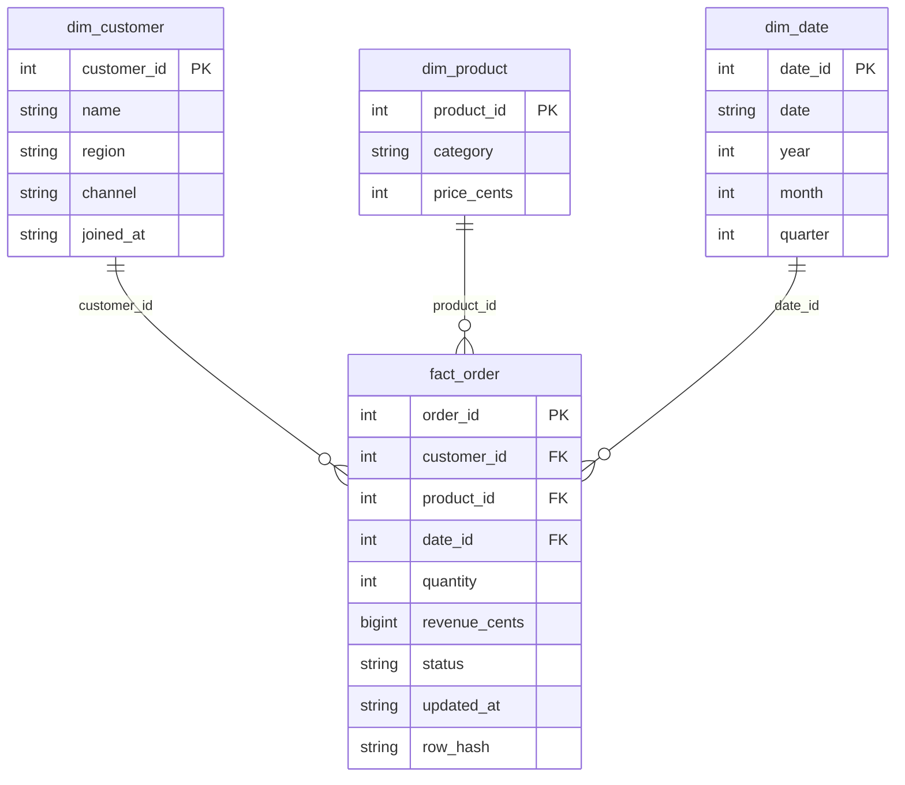

Além do esquema estrela, `app_state` persiste checkpoints, tarefas e resultados estruturados. `pipeline_run` registra status, início, fim, duração, detalhes e classe de erro das execuções.

| Indicador | Regra implementada |
| --- | --- |
| Receita líquida | Soma de `revenue_cents` dividida por 100; cancelados têm receita zero |
| Pedidos | Todos os pedidos do recorte, incluindo cancelados |
| Clientes | Distintos com pedidos no filtro; não é todo o cadastro |
| Ticket do cartão KPI | Receita média dos pedidos concluídos |
| Cancelamento | Cancelados / todos os pedidos × 100 |
| Recompra | Compradores com mais de uma compra concluída / compradores concluídos × 100 |
| Variação mensal | `(receita último mês / receita mês anterior − 1) × 100` |
| Ticket da série mensal | Receita mensal / todos os pedidos do mês |
| Alto risco | Probabilidade ≥ limiar validado do classificador |
| Receita prevista | Valor semanal ou soma da previsão pontual |

**O ticket mensal e o cartão KPI têm denominadores diferentes.** A série mensal inclui cancelados na contagem de pedidos; o cartão considera concluídos. O crescimento fica indisponível quando não há mês anterior comparável ou o denominador é zero.

A tabela comercial apresenta até **2.000 pedidos recentes**, com limite identificado. Sua exportação não equivale à exportação integral do banco. Filtros comerciais não retreinam modelos nem alteram a população da avaliação.

## Instalação completa no Windows

### 1. Pré-requisitos

- Git no terminal.
- Python 3.13 de 64 bits, runtime de referência.
- Node.js entre `20.19` e `24.x`, faixa aceita pelo script n8n, e npm.
- PowerShell e dois terminais no VSCode.
- Internet na instalação inicial.

Docker e Ollama são opcionais para começar com SQLite. Os modelos estatísticos usam CPU; GPU é opcional para LLM. Não é preciso contratar serviços externos.

### 2. Clonar

```powershell
cd C:\dev
git clone https://github.com/ViniciusKanh/Predictive-BI-n8n-workflows.git Predictive-BI
cd C:\dev\Predictive-BI
```

Se a pasta já existe, abra a instalação existente. Não clone sobre dados importantes.

### 3. Gerar configuração

```powershell
.\scripts\Initialize-Environment.ps1
```

O script cria `.env` somente se ausente, com senha e chave n8n aleatórias. Preserva configurações existentes e não imprime segredos. `.env.example` documenta as variáveis.

### 4. Instalar dependências

O script de início também prepara dependências quando necessário. Para acompanhar explicitamente a instalação nova:

```powershell
python -m venv .venv
.\.venv\Scripts\python.exe -m pip install --upgrade pip
.\.venv\Scripts\python.exe -m pip install -r requirements.txt
Push-Location frontend
npm install --no-audit --no-fund
npm run build
Pop-Location
```

Não é necessário ativar o virtualenv: os comandos usam seu executável. Não copie `.venv` ou `node_modules` de outra máquina como procedimento de instalação.

### 5. Gerar dados, treinar e iniciar a API

No **terminal 1**:

```powershell
cd C:\dev\Predictive-BI
.\scripts\Start.ps1 -Mode Native -Database SQLite -Foreground -Port 8101
```

Na primeira execução **não use `-SkipTraining`**, pois não há modelos preparados. O script seleciona SQLite explicitamente, executa ETL, qualidade, treino, inferência e insights e serve o dashboard.

Abra **http://127.0.0.1:8101**. Até publicar os backends, o modo n8n pode informar indisponibilidade. Escolha **Python · direto** se quiser inspecionar os dados enquanto configura o editor.

Se o seu Windows apresentar o problema específico do socketpair do loop asyncio:

```powershell
.\scripts\Start.ps1 -Mode Native -Database SQLite -RestrictedLoop -Foreground -Port 8101
```

`-RestrictedLoop` muda somente a sincronização interna do loop. Não altera rede, firewall ou permissões. Use apenas quando necessário.

### 6. Iniciar o editor n8n

Abra o **terminal 2**, sem encerrar o primeiro:

```powershell
cd C:\dev\Predictive-BI
.\scripts\Start-N8n.ps1 -ApiUrl http://127.0.0.1:8101
```

O script prepara sete workflows, reutiliza/instala n8n 2.45.6 em `.runtime/n8n-tool`, verifica o driver SQLite, tenta importar os JSONs e inicia o serviço. Se um n8n saudável já estiver em 5678, preserva a instância e informa o endereço. Nesse caso, importe pelo editor.

Abra **http://localhost:5678** e crie o usuário administrador local se solicitado. Preserve `.env` e `N8N_ENCRYPTION_KEY`: a chave é necessária para recuperar credenciais do n8n.

### 7. Usar o editor normal, sem configurar Assistant

A tela **Assistant** pode pedir Gemini, sandbox ou busca web. Esses componentes não são necessários. Abra **Overview** e o editor normal. O analista do dashboard usa Ollama no worker; é independente do Assistant do n8n.

### 8. Reiniciar com dados e modelos existentes

```powershell
.\scripts\Start.ps1 -Mode Native -Database SQLite -SkipTraining -Foreground -Port 8101
```

Se necessário, mantenha `-RestrictedLoop`. Se aparecer `API respondeu ao healthcheck`, o serviço já está ativo; abra a URL. Não inicie outra instância na mesma porta.

### 9. Scripts bloqueados pelo PowerShell

Sem alterar permanentemente a política global, pode-se executar em um processo próprio:

```powershell
powershell.exe -NoProfile -ExecutionPolicy Bypass -File .\scripts\Start.ps1 -Mode Native -Database SQLite -Foreground -Port 8101
```

Respeite as políticas de uma máquina administrada. Não é necessário desativar antivírus ou VPN.

## Importação e publicação no n8n

### Passo a passo dos dois backends

1. Entre em **Overview** na lateral.
2. Escolha **Add workflow** ou **Start from scratch**.
3. No editor, abra **⋯** no canto superior direito.
4. Escolha **Import from File**.
5. Importe `C:\dev\Predictive-BI\workflows\local\backend-data.json`.
6. Clique **Publish** e use `v1.0.0 — API de leitura do dashboard` como nome de versão.
7. Crie **outro workflow** e importe `backend-actions.json`.
8. Publique com `v1.0.0 — API de execução de pipelines`.

Cada JSON representa um workflow separado. Importar outro arquivo no mesmo canvas pode substituir o conteúdo anterior. Os geradores permitem reconstruir os arquivos originais no disco.

| Endpoint | Disponibilidade | Finalidade |
| --- | --- | --- |
| `/webhook-test/...` | Editor aguardando teste | Depuração pontual |
| `/webhook/predictive-bi-data` | Backend de leitura publicado | GET do dashboard |
| `/webhook/predictive-bi-actions` | Backend de ações publicado | POST do dashboard |

**Execute workflow não substitui Publish.** O dashboard usa URLs de produção. Publicar `complete.json` não publica os dois backends HTTP.

Depois de publicar, selecione **n8n · workflows** no dashboard e atualize. Abra **Executions** no backend de leitura: a interface consulta analytics, modelos, qualidade, pipelines, insights e status. Uma ação como Verificar qualidade deve aparecer no backend de ações e no acompanhamento de tarefa.

```powershell
Invoke-RestMethod http://127.0.0.1:8101/health
Invoke-RestMethod http://localhost:5678/healthz
Invoke-RestMethod 'http://localhost:5678/webhook/predictive-bi-data?resource=quality'
Invoke-RestMethod http://127.0.0.1:8101/workflow-api/quality
```

Se os dois primeiros funcionarem e o webhook não existir, confira o caminho do nó e a publicação. Preserve instâncias e dados; não encerre outro processo para forçar a mesma porta.

## Os sete workflows explicados

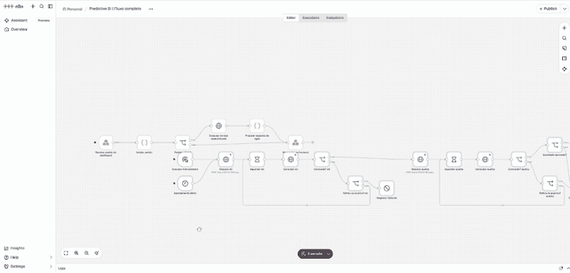

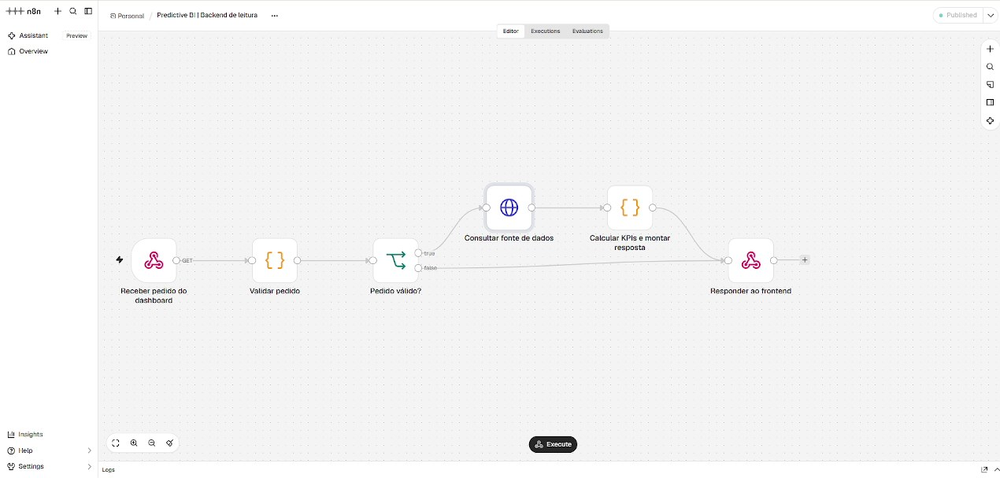

O [catálogo de nós](docs/workflow-catalog.md) lista os nomes e tipos reais presentes nos JSONs. As fontes dos arquivos são `scripts/generate_workflows.py`, `scripts/generate_n8n_backend.py` e `workflows/code/analytics.cjs`.

| JSON local | Nome no editor | Encadeamento |
| --- | --- | --- |
| `etl.json` | Predictive BI \| ETL | ETL → qualidade |
| `predictive.json` | Predictive BI \| Predictive Analytics | Treinamento/avaliação → inferência |
| `insights.json` | Predictive BI \| GenAI Insights | Evidências → análise → persistência |
| `quality.json` | Predictive BI \| Data Quality | Integridade e reconciliação |
| `complete.json` | Predictive BI \| Fluxo completo | ETL → qualidade → treino → inferência → insights |
| `backend-data.json` | Predictive BI \| Backend de leitura | Webhook GET → regras → resposta |
| `backend-actions.json` | Predictive BI \| Backend de ações | Webhook POST → validação → despacho |

### Backend de leitura: cada nó

1. **Receber pedido do dashboard — Webhook:** recebe GET em `predictive-bi-data` e usa resposta por nó específico.
2. **Validar pedido — Code:** aceita recursos conhecidos, datas válidas, limites de filtros e IDs de tarefas válidos. O navegador não escolhe uma URL arbitrária.
3. **Pedido válido? — IF:** chamadas inválidas seguem para resposta `422`; válidas consultam a fonte.
4. **Consultar fonte de dados — HTTP Request:** analytics busca `/internal/orders`; os outros recursos consultam resultados persistidos no worker.
5. **Calcular KPIs e montar resposta — Code:** aplica filtros, soma centavos inteiros e calcula séries e rankings comerciais. Nos outros recursos preserva a resposta do worker.
6. **Responder ao frontend — Respond to Webhook:** entrega JSON, status e identificação do backend.

As regras comerciais estão em `workflows/code/analytics.cjs` e são inseridas no JSON pelo gerador. Alterar o fonte exige regenerar, importar e publicar novamente para atualizar o workflow em uso.

### Backend de ações: cada etapa

1. O Webhook recebe POST em `predictive-bi-actions`.
2. O Code valida `jobs` ou `analyst`, pipelines permitidos e pergunta de até 1.000 caracteres.
3. O IF impede disparos quando a entrada é inválida.
4. O HTTP Request chama `/api/jobs` para tarefa assíncrona ou `/api/analyst` para análise.
5. A chave de idempotência recebida é preservada; na ausência, há uma vinculada à execução.
6. A resposta mantém corpo e status do worker. Em jobs, `202` devolve ID; o frontend consulta o backend de leitura para acompanhar.

### Padrão compartilhado pelos pipelines

| Nó | Função | Saída a conferir |
| --- | --- | --- |
| Disparar etapa | POST `/api/jobs` | ID, `queued_at`, status inicial |
| Aguardar etapa | Wait de dois segundos | Intervalo entre consultas |
| Consultar etapa | GET `/api/jobs/{id}` | Status real e resultado |
| Concluído? etapa | IF de `status === success` | Libera próxima etapa apenas no sucesso |
| Falhou ou expirou? etapa | IF de falha ou dez minutos | Decide continuar polling ou parar |
| Registrar falha etapa | Stop And Error | Interrompe com erro explícito |

As chamadas HTTP têm retentativas finitas. A chave `n8n-{execution.id}-{etapa}` evita repetir efeitos em retentativas da mesma execução. Uma nova execução manual recebe outra chave e pode executar novamente uma tarefa intencional.

### ETL: como os dados entram

1. Gerar ou reutilizar os CSVs e manifesto.
2. Rejeitar chaves duplicadas em dimensões e pedidos.
3. Ler `etl_watermark` anterior.
4. Capturar candidatos a partir de sete dias antes do checkpoint, tolerando chegadas tardias nessa janela.
5. Validar Pydantic: chaves/quantidades positivas, valores, datas, status e identidade da receita.
6. Verificar clientes e produtos na origem e calcular `row_hash` de cada candidato.
7. Abrir transação, fazer upsert de dimensões e carregar calendário.
8. Comparar hashes e escrever somente pedidos novos ou alterados.
9. Atualizar watermark e manifesto na mesma transação.
10. Registrar contagens, duração, status e identificador de execução.

O PostgreSQL usa também advisory lock transacional; o processo possui lock Python. Erros não devem confirmar carga parcial nem avançar checkpoint.

**O ETL ainda lê o CSV completo.** A incrementalidade reduz validações elegíveis e escritas, não transforma a leitura em streaming. Não há CDC de logs, captura automática de exclusões ou garantia para correções antigas sem `updated_at` apropriado.

### Data Quality: o gate

São nove checks: integridade de cliente, produto e calendário; receita/descontos; unicidade de pedidos; quantidade positiva; duplicidade na origem; campos ausentes na origem; reconciliação exata de receita em centavos.

Uma tarefa de qualidade pode terminar tecnicamente sem erro e encontrar inconsistências. Por isso, **Qualidade aprovada?** exige `total > 0` e `passed === total` antes de permitir o treino. Inspecione a saída de cada check, não somente o status de execução.

### Predictive Analytics

O fluxo dispara `train`, acompanha a conclusão de previsão, churn e segmentação, e depois dispara `infer`. A inferência carrega `revenue.joblib` e atualiza as previsões persistidas. Falha no treino não libera a próxima etapa.

### GenAI Insights

O fluxo dispara `insights`. O worker reúne indicadores calculados, solicita uma seleção estruturada ao Qwen quando disponível, valida a resposta e persiste achados com evidências. Sem geração válida, usa modo determinístico identificado. Isso não é uma execução fictícia de LLM.

### Fluxo completo: 33 nós

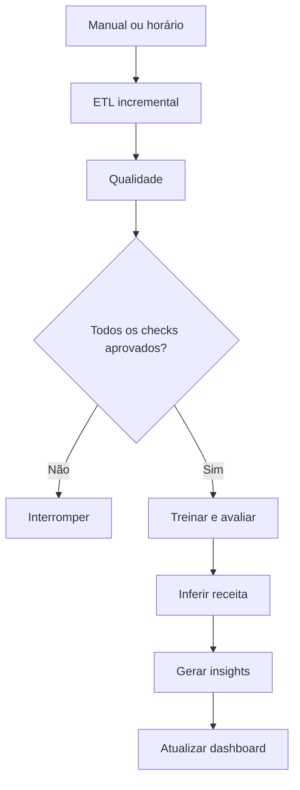

Importe `complete.json` em um workflow próprio e clique **Execute workflow** para testar manualmente. Ele não precisa ser publicado para um teste pelo gatilho manual. **Publicá-lo habilita também seu agendamento diário.**

| Fluxo agendável | Horário configurado em America/Sao_Paulo |
| --- | --- |
| ETL | 02h |
| Completo | 02h |
| Preditivo | 03h |
| Insights | 04h |
| Qualidade | 05h |

Escolha o completo ou uma coordenação dos independentes. Não publique todos sem planejamento: pode haver treinos repetidos e conflitos `409`. O completo tem timeout global de uma hora; os outros pipelines, vinte minutos. O polling limita cada etapa a dez minutos.

### Regenerar os JSONs

```powershell
.\.venv\Scripts\python.exe scripts/generate_workflows.py --base-url http://127.0.0.1:8101 --output workflows/local --include-master
.\.venv\Scripts\python.exe scripts/generate_n8n_backend.py --api-url http://127.0.0.1:8101 --output workflows/local
```

Faça backup de mudanças manuais antes: os comandos regravam arquivos gerados. A regeneração no disco não altera automaticamente o workflow salvo no editor.

## Guia de análise do dashboard

### Roteiro recomendado

Comece por Data Quality, confirme período em Overview, explore Sales Analytics, leia Model Performance e então interprete previsão, churn e segmentos. Use AI Analyst para resumir evidências e Pipeline Monitoring para conferir atualização.

Os filtros comerciais afetam os agregados comerciais. Modelos, segmentos e analista usam os snapshots/população definidos no processamento, não um novo treino para cada filtro.

### 1. Overview

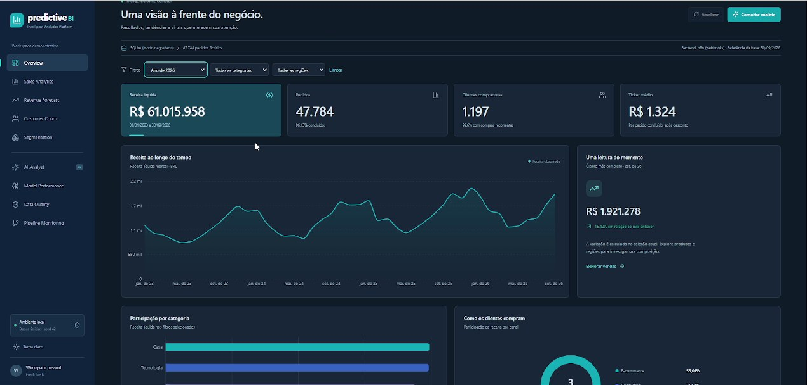

**Pergunta:** qual o resultado do recorte e o que merece investigação?

- Leia receita, pedidos, clientes e ticket juntos.
- Compare evolução mensal e composição por categoria/região.
- Confira cancelamento e recompra antes de atribuir mudanças a volume ou preço.
- Observe a identificação de dados demonstrativos e banco selecionado.

**Exercício:** compare todas as regiões com Sul. Os agregados devem mudar de acordo com o recorte; a métrica do modelo continua ligada à avaliação original.

### 2. Sales Analytics

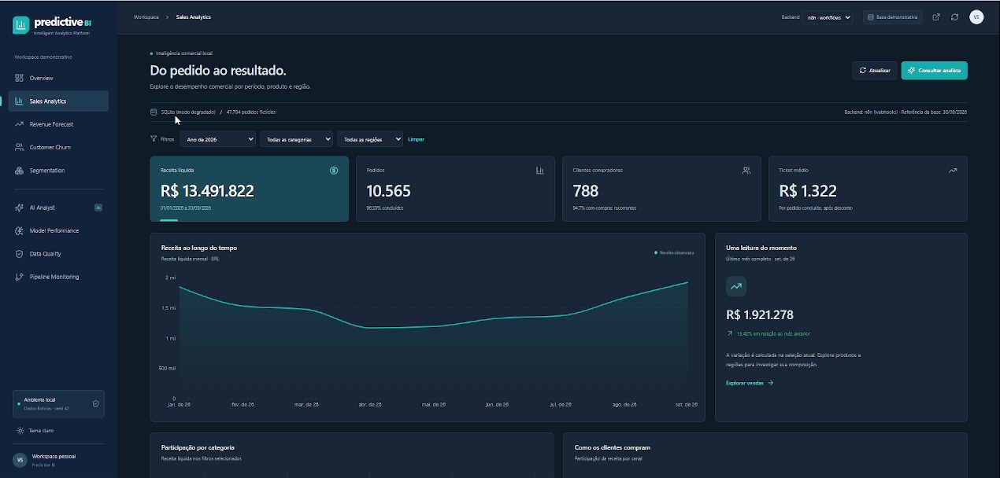

**Pergunta:** como a receita se distribui por produtos, canais e tempo?

- Use séries para reconhecer sazonalidade e mudança de volume.
- Compare ranking comercial e participação de canais.
- O mapa de calor cruza mês e dia da semana. Concentração não demonstra causalidade.
- Pesquise/ordene pedidos para conferir exemplos que sustentam os agregados.
- A exportação da tabela limita-se à amostra de até 2.000 pedidos.

**Exercício:** filtre categoria e período, compare canais e confira pedidos individuais. Não use a amostra da tabela como denominador do total.

### 3. Revenue Forecast

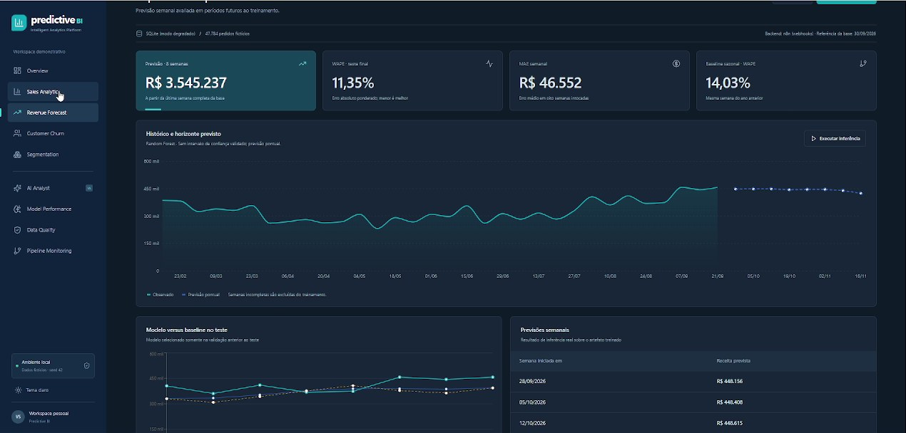

**Pergunta:** qual é a referência de receita para as oito semanas seguintes ao histórico?

- A série observada usa semanas completas.
- A projeção parte da última semana completa da base, não da data atual do computador.
- Consulte WAPE e MAE e compare com o baseline.
- Veja observado/modelo/baseline no teste final.
- Não há intervalo de confiança validado nem garantia de faturamento.

**Exercício:** WAPE de 11% é erro agregado no teste; não significa “89% de acurácia” nem margem garantida de ±11% para cada semana.

### 4. Customer Churn

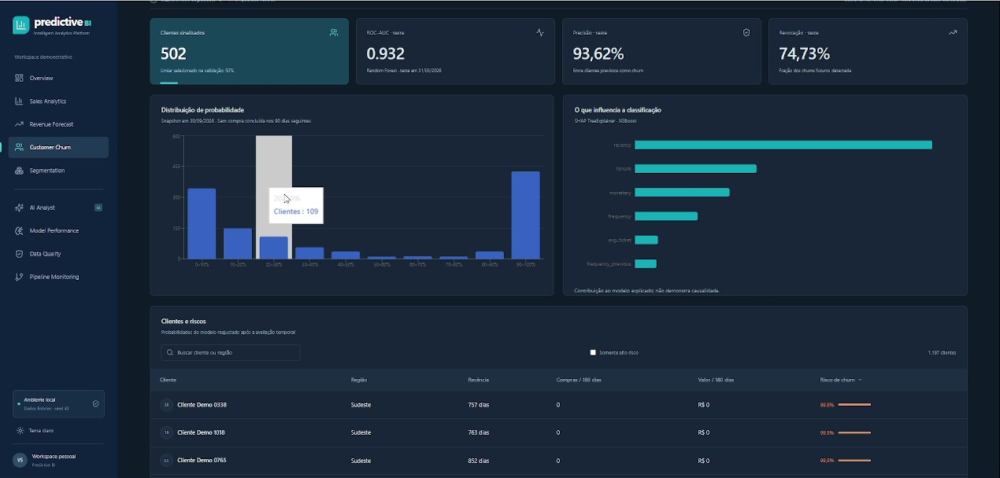

**Pergunta:** quem tem maior risco de não comprar nos próximos 90 dias?

- A distribuição mostra probabilidades dos clientes pontuados.
- Alto risco é probabilidade acima do limiar escolhido na validação.
- Compare risco, recência, frequência e valor na tabela.
- Precisão descreve os sinalizados no teste; revocação descreve os churns detectados.
- Confira o nome do modelo explicado antes de interpretar SHAP.

**Exercício:** revise clientes de alto risco para priorizar investigação. Risco não é saída confirmada; não há campanha de retenção enviada automaticamente.

### 5. Segmentation

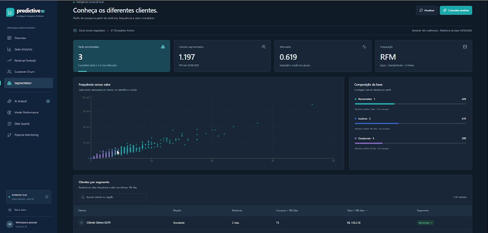

**Pergunta:** quais perfis de comportamento a base contém?

- Cada ponto é um cliente; cor representa cluster.
- Compare frequência e receita, tamanho dos grupos e recência média.
- Inativos, Recorrentes e Ocasionais são rótulos heurísticos pós-agrupamento.
- Silhouette mede separação no espaço transformado, não retorno financeiro da segmentação.

**Exercício:** compare um grupo frequente com outro de alta recência e proponha ações distintas, indicando quais dados faltam para medir retorno.

### 6. AI Analyst

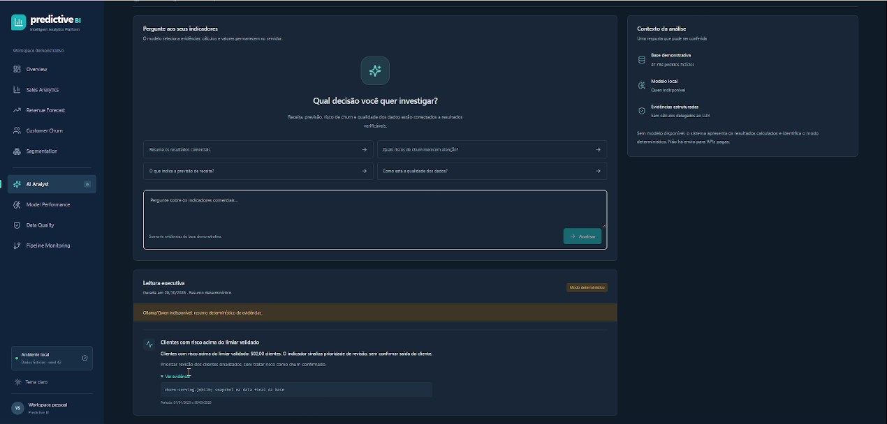

Use perguntas como:

```text
Resuma os resultados comerciais.
Quais riscos de churn merecem atenção?
O que indica a previsão de receita?
Como está a qualidade dos dados?
```

Abra **Ver evidência** para conferir fonte e período. Observe **Qwen local**, **Resumo determinístico** ou evidência insuficiente. O analista não conhece causas externas, concorrentes, custos ou fatos de mercado ausentes do contexto.

### 7. Model Performance

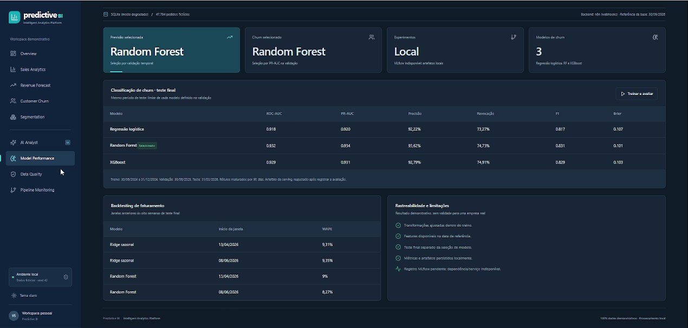

**Pergunta:** o resultado veio de avaliação adequada e supera uma referência simples?

- Compare ROC-AUC, PR-AUC, precisão, revocação, F1 e Brier no mesmo teste.
- Confira snapshots de treino, validação e teste.
- Examine backtesting e baseline da receita.
- Veja se o tracking está registrado no MLflow ou apenas local.
- Compare reavaliações somente com dataset e definição de alvo compatíveis.

**Exercício:** maior precisão com menor revocação exige discutir custo de abordagem desnecessária versus churn não detectado. O projeto não fornece uma matriz de custos corporativa real.

### 8. Data Quality

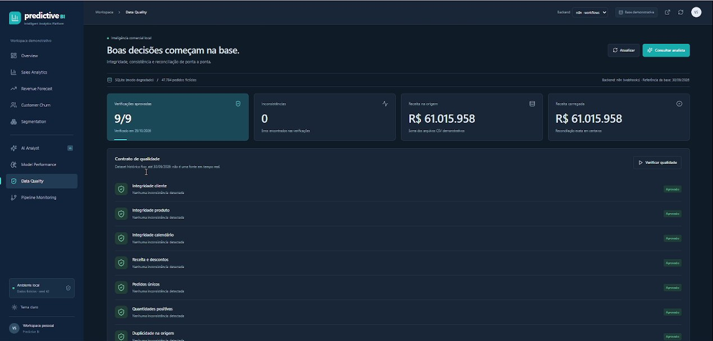

**Pergunta:** a base está íntegra e reconciliada?

- Confira os nove checks individualmente.
- Compare receita de origem e banco em centavos.
- Corrija falhas antes de treinar.
- O histórico fixo até setembro de 2026 não é um feed atrasado em tempo real.

O total de “inconsistências” na interface mistura contagens com diferença monetária em centavos do check de reconciliação. Para diagnosticar, leia cada check; esse total não é uma contagem homogênea de linhas inválidas.

### 9. Pipeline Monitoring

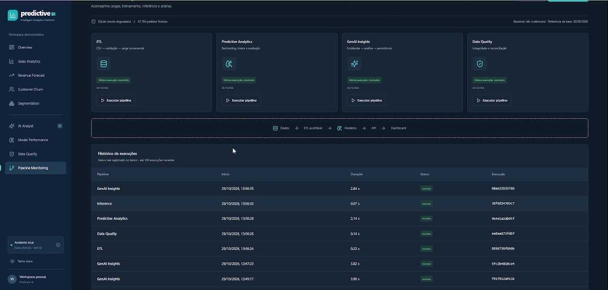

**Pergunta:** qual processamento ocorreu, quando e com qual resultado?

- Cartões executam tarefas pelo backend selecionado.
- A tabela mostra até 100 registros de `pipeline_run`.
- Diferencie `success`, `failed`, `running` e `interrupted`.
- Ao reiniciar o worker, tarefas antigas em andamento são marcadas como interrompidas/falhas.
- Confira também Executions no n8n: histórico Python não comprova execução no motor n8n.

## Machine Learning e avaliação

### Previsão de receita

1. Agregar receita diária e preencher dias sem vendas com zero.
2. Formar semanas iniciadas na segunda-feira e excluir incompletas.
3. Construir tendência e componentes seno/cosseno anuais e semestrais.
4. Comparar Ridge sazonal, Random Forest e baseline de 52 semanas.
5. Fazer duas validações de oito semanas anteriores ao teste final.
6. Selecionar menor WAPE médio de validação.
7. Avaliar nas oito semanas finais reservadas.
8. Reajustar no histórico completo e gerar oito semanas futuras.
9. Persistir artefato, parâmetros, hashes e métricas.

Os atributos de calendário não usam vendas futuras. Não há LSTM, busca Optuna ou ensemble de previsão implementados. O teste final não escolhe o vencedor.

### Churn

**Alvo:** nenhuma compra concluída nos 90 dias posteriores ao snapshot. O rótulo só é criado quando essa janela futura está disponível.

| Partição | Data(s) |
| --- | --- |
| Treino | 30/06/2024 e 31/12/2024 |
| Validação | 30/06/2025 |
| Teste | 31/03/2026 |
| Inferência | Data final da base |

Atributos: recência, frequência e valor nos últimos 180 dias, tempo desde a primeira compra, ticket médio e frequência nos 180 dias anteriores. Compras futuras são usadas somente para rotular.

Regressão logística inclui StandardScaler em pipeline. Random Forest e XGBoost usam parâmetros explícitos. Cada limiar é escolhido entre `0,15` e `0,85` na validação por F1; o vencedor é selecionado por PR-AUC de validação. Há baseline de probabilidade constante com prevalência de treino.

Depois de avaliar, o vencedor é reajustado nos snapshots históricos para serving. **As métricas de teste pertencem ao modelo pré-reajuste**, não a uma avaliação independente do artefato final. Clientes podem aparecer em snapshots diferentes: a generalização é temporal na população observada, não para outra empresa.

### Segmentação RFM

- R: dias desde a última compra concluída.
- F: compras concluídas em 180 dias.
- M: receita líquida dessas compras em BRL.

Aplicam-se `log1p`, StandardScaler e K-Means para `k = 3, 4, 5`. O maior silhouette escolhe K, usando amostra de até 1.000 clientes com seed fixa. Não há rótulos supervisionados de segmento.

### SHAP

TreeExplainer utiliza até 128 exemplos do teste. Quando disponível, explica XGBoost; caso contrário, Random Forest. `explained_model` identifica qual classificador foi explicado. **Não atribua a explicação de XGBoost automaticamente ao Random Forest selecionado.** SHAP não comprova causalidade.

### Resultados medidos de referência

Os valores abaixo foram medidos no dataset sintético seed 42. Não são constantes usadas para preencher o frontend; o dashboard lê os resultados persistidos.

| Resultado | Valor de referência |
| --- | --- |
| Receita — Random Forest — WAPE teste | 11,3548% |
| Receita — MAE semanal | R$ 46.552,12 |
| Receita — RMSE semanal | R$ 52.439,16 |
| Receita — baseline sazonal — WAPE teste | 14,0322% |
| Churn — Random Forest — ROC-AUC | 0,931869 |
| Churn — PR-AUC | 0,934459 |
| Churn — precisão | 0,936219 |
| Churn — revocação | 0,747273 |
| Churn — F1 | 0,831143 |
| RFM/K-Means — silhouette | 0,618657 |
| Qualidade | 9/9 checks aprovados |

Veja [evidências e baseline](docs/reference-results.json). Depois de outro treino, consulte sua API e artefatos. Mudanças no ambiente ou dataset podem alterar os números. Não existe garantia de desempenho equivalente em dados reais.

### Tracking

O código registra seed, hashes de dataset/código/artefato, parâmetros, métricas e horário. MLflow recebe o experimento **Predictive BI Demonstrativo** quando acessível. Sem pacote ou serviço, JSONs locais em `artifacts/` registram `mlflow_status: pending` e a razão. Fallback local não é registro MLflow aprovado.

## Ollama e IA com evidências

Confira primeiro modelos existentes:

```powershell
ollama list
```

No `.env`, selecione um Qwen já instalado; exemplo:

```dotenv
OLLAMA_BASE_URL=http://127.0.0.1:11434
OLLAMA_MODEL=qwen2.5:3b
```

Esse modelo foi encontrado no ambiente de desenvolvimento, mas só funciona em outra máquina se estiver instalado. Reinicie o worker depois de alterar variáveis. Não baixe outro modelo sem conferir os existentes.

A seleção automática consulta `/api/tags`, filtra Qwen local de geração, exclui cloud/embedding/rerank e considera arquivos menores que 7 GB. Isso é uma heurística, não garantia de caber na GPU; Ollama pode utilizar CPU/RAM.

O modelo recebe pergunta e evidências com IDs, valor, unidade, fonte e período. Retorna somente métricas, interpretações e recomendações dentro de um esquema permitido. Pydantic e regras adicionais rejeitam IDs inexistentes, duplicados, tendências contraditórias e recomendações incompatíveis.

**O servidor renderiza valores e texto factual.** O LLM não estima faturamento por texto. Perguntas fora das evidências recebem insuficiência de contexto. A pergunta é tratada como dado não confiável no prompt.

| Modo | Significado |
| --- | --- |
| `ollama` | Chamada local e resposta validada |
| `deterministic` | Resumo de evidências sem geração válida de LLM |
| `insufficient_evidence` | Pergunta sem contexto suficiente |

Gemini, Hugging Face Inference Providers e Daytona não integram o analista implementado. Configurar Gemini no n8n Assistant não modifica esse backend. Nenhum token externo é exigido para os fluxos fornecidos.

## Docker Compose e PostgreSQL

O Compose define PostgreSQL, MLflow, FastAPI, frontend Nginx e n8n. Ollama permanece no host. Volumes preservam PostgreSQL, n8n e MLflow; dados/artefatos são montados no worker.

```powershell
.\scripts\Initialize-Environment.ps1
docker compose config --quiet
.\scripts\Start.ps1 -Mode Docker
```

`docker --version` confirma somente o cliente. `docker info` precisa funcionar para confirmar o Engine.

### Importar fluxos Docker

```powershell
.\scripts\Import-N8n.ps1
```

São importados quatro pipelines de `workflows/` e dois backends de `workflows/docker-backend/`, com destino `http://api:8000`. Abra `http://localhost:5680`, complete o cadastro local se necessário e publique os dois backends.

O `complete.json` local aponta para 8101. Para criar uma versão apropriada ao container:

```powershell
.\.venv\Scripts\python.exe scripts/generate_workflows.py --base-url http://api:8000 --output workflows/docker --include-master
```

Importe `workflows/docker/complete.json` pelo editor. O proxy do worker Compose já usa `N8N_BASE_URL=http://n8n:5678`. Não confunda portas do host com DNS interno dos containers.

### Parar sem apagar volumes

```powershell
.\scripts\Stop.ps1 -Mode Docker
```

O comando usa `docker compose stop`. Não use `down -v` como rotina: remover volumes apaga persistência e não integra o procedimento seguro de parada.

### PostgreSQL fora do Docker

Configure `DATABASE_URL` no `.env` e inicie com `-Database PostgreSQL`. O bootstrap pode criar `predictive_bi` se o usuário tiver permissão; caso contrário, provisione o banco antes.

O script nativo permite fallback SQLite e o identifica. Para exigir PostgreSQL sem fallback:

```powershell
.\.venv\Scripts\python.exe scripts/bootstrap.py --database-mode configured --task etl
```

Não use `--allow-sqlite-fallback` nessa verificação estrita. Selecionar PostgreSQL não migra o arquivo SQLite; os mesmos CSVs podem ser carregados no novo destino sem apagar a base anterior.

## API e exemplos

| Método | Rota | Finalidade |
| --- | --- | --- |
| GET | `/health` | Identidade e saúde do banco |
| GET | `/internal/orders` | Fonte das regras comerciais n8n |
| GET | `/api/analytics` | Referência Python e filtros |
| GET | `/api/models` | Modelos, previsão, churn e segmentos |
| GET | `/api/quality` | Checks persistidos |
| GET | `/api/pipelines` | Até 100 execuções |
| GET | `/api/insights` | Última análise |
| GET | `/api/status` | Banco, Ollama, manifesto e tracking |
| POST | `/api/jobs` | Tarefa assíncrona, resposta 202 |
| GET | `/api/jobs/{id}` | Acompanhamento de tarefa |
| POST | `/api/analyst` | Análise verificável |
| GET/POST | `/workflow-api/...` | Proxy para os webhooks n8n |

### Executar qualidade pelo backend n8n

```powershell
$headers = @{ 'Idempotency-Key' = 'demo-qualidade-001' }
$body = @{ pipeline = 'quality' } | ConvertTo-Json
$job = Invoke-RestMethod `
  -Method Post `
  -Uri http://127.0.0.1:8101/workflow-api/jobs `
  -ContentType 'application/json' `
  -Headers $headers `
  -Body $body

Invoke-RestMethod "http://127.0.0.1:8101/workflow-api/jobs/$($job.id)"
```

A mesma chave e pedido retornam a resposta registrada. A mesma chave com outro conteúdo retorna conflito. Um novo processamento intencional deve usar outra chave.

```powershell
Invoke-RestMethod 'http://127.0.0.1:8101/workflow-api/analytics?start=2026-01-01&end=2026-09-30&region=Sul'
```

| HTTP | Interpretação possível |
| --- | --- |
| 200 | Consulta/análise concluída |
| 202 | Tarefa aceita; acompanhar status |
| 404 | Recurso/tarefa inexistente |
| 409 | Tarefa pesada em andamento ou conflito de idempotência |
| 422 | Entrada inválida |
| 502 | Webhook retornou conteúdo não JSON |
| 503 | n8n indisponível, webhook não publicado ou banco sem saúde |

## Testes e verificações

Prepare a demonstração pelo ETL antes dos testes se o clone ainda não contém os CSVs.

```powershell
.\.venv\Scripts\python.exe -m pytest -q --basetemp=.runtime/pytest
Push-Location frontend
npm run build
Pop-Location
docker compose config --quiet
```

Ruff está declarado nas dependências. Se instalado no seu venv:

```powershell
.\.venv\Scripts\python.exe -m ruff check backend scripts tests
```

Não interprete ferramenta ausente como lint aprovado. `requirements-tested.txt` registra versões da execução original; não substitui testar uma instalação limpa.

### Invariantes cobertas

- Reexecução de ETL não duplica nem regrava pedidos sem alteração.
- Correção tardia atualiza o registro existente.
- Erros não avançam watermark nem confirmam lote parcial.
- Órfãos, duplicações e valores inconsistentes são rejeitados.
- Atributos de churn respeitam snapshot e maturação de rótulos.
- Agente rejeita evidências e interpretações contraditórias.
- JSONs preservam nós, conexões, polling, retentativas e gate.
- JavaScript comercial é comparado com a referência Python em recortes reais da demonstração.
- Proxy preserva contratos e não contorna falhas do n8n.
- Verificador SQLite distingue pacote presente de consulta realmente executada.

### Limites da evidência

TestClient e MockTransport não comprovam rede TCP. Importação CLI não comprova publicação ou execução de webhook. SQLite não comprova integração PostgreSQL. Histórico Python não comprova motor n8n. Veja [verificação da publicação](docs/publication-verification.md) para os resultados desta revisão.

## Operação e problemas frequentes

### Executar etapas separadas

Para reutilizar o banco de `.runtime/local.env`:

```powershell
.\.venv\Scripts\python.exe scripts/bootstrap.py --database-mode existing --task etl
.\.venv\Scripts\python.exe scripts/bootstrap.py --database-mode existing --task quality
.\.venv\Scripts\python.exe scripts/bootstrap.py --database-mode existing --task train
.\.venv\Scripts\python.exe scripts/bootstrap.py --database-mode existing --task infer
.\.venv\Scripts\python.exe scripts/bootstrap.py --database-mode existing --task insights
```

Use `--database-mode sqlite` para selecionar SQLite explicitamente. Use `configured` sem fallback para exigir o destino principal. Evite disparar tarefas CLI simultaneamente com um treino pelo dashboard.

### Outro cenário sem sobrescrever o existente

```powershell
$env:DATA_DIR = Join-Path (Get-Location) 'data-outro-cenario'
.\.venv\Scripts\python.exe -c "from backend.dataset import generate; print(generate())"
Remove-Item Env:DATA_DIR
```

Isso cria outra cópia com as constantes atuais. Alterar seed/período exige revisar o gerador de forma versionada e manter outro diretório. Não apague o manifesto histórico para forçar regeneração.

### Parar e preservar dados

Use Ctrl+C nos terminais em primeiro plano da API e do n8n. `Stop.ps1 -Mode Native` pode parar o cluster PostgreSQL exclusivo e uma API identificada por arquivo de PID; um processo em primeiro plano deve ser parado no seu terminal. O Ollama compartilhado não é encerrado automaticamente.

Não mate processos desconhecidos para liberar portas. Escolha porta livre e regenere os workflows/configuração correspondentes.

### Backup

Preserve `.env` com acesso restrito, `.runtime/n8n-home`, CSVs/manifesto, banco e `artifacts/`. Para cópia simples de SQLite/n8n, pare os serviços antes ou use backup consistente. Para PostgreSQL, use `pg_dump` sem expor credenciais no histórico. Não publique backups no GitHub.

### Diagnóstico rápido

| Sintoma | Causa possível | Ação |
| --- | --- | --- |
| 503 em `/workflow-api` | n8n parado ou backend não publicado | Verificar health, publicar ambos e conferir `N8N_BASE_URL` |
| Completo funciona, frontend não | Falta o backend HTTP | Publicar `backend-data` e `backend-actions` |
| Nó HTTP não conecta | Worker parado/URL errada | Local usa 8101; container usa `api:8000` |
| Script retorna API saudável | Processo já ativo | Abrir a URL |
| n8n já ativo | Porta 5678 em uso por serviço saudável | Reutilizar editor |
| SQLite package ausente no n8n | Driver nativo não compilado/instalado | Executar reparo local |
| Ollama não responde | Serviço/modelo/validação indisponível | Conferir modelos e modo do resultado |
| MLflow pendente | Dependência/servidor indisponível | Conferir JSON e iniciar tracking antes de novo treino |
| Histórico termina em setembro/2026 | Cenário fixo sintético | Não interpretar como fonte em tempo real |
| ENOTFOUND/DNS | Host/registro inacessível ao processo | Corrigir conectividade, preservando instalações |

```powershell
.\scripts\Repair-N8n.ps1
```

O reparo limita aprovação/rebuild ao sqlite3 da instalação gerenciada. Não relaxa globalmente a segurança de scripts npm. O diagnóstico final precisa confirmar uma consulta SQLite.

### Frontend em desenvolvimento

Com o worker ativo em 8101:

```powershell
Push-Location frontend
npm run dev
Pop-Location
```

Abra `http://127.0.0.1:5180`. O proxy Vite encaminha chamadas ao worker. Para outra porta, defina `API_PROXY_TARGET` no processo antes de iniciar Vite.

## Organização do repositório

| Caminho | Responsabilidade |
| --- | --- |
| `backend/dataset.py` | Cenário sintético |
| `backend/db.py` | Conexões, DDL, SQL e estado |
| `backend/pipelines.py` | ETL, qualidade e auditoria |
| `backend/ml.py` | Modelos, avaliação, SHAP e inferência |
| `backend/insights.py` | Evidências, Ollama e validação |
| `backend/main.py` | API, tarefas e serving |
| `backend/n8n_gateway.py` | Proxy e destinos permitidos |
| `frontend/src/App.tsx` | Páginas, ações e gráficos |
| `frontend/src/api.ts` | Seleção de backend e requisições |
| `workflows/code/analytics.cjs` | Regras comerciais do nó Code |
| `workflows/local/` | Sete fluxos nativos |
| `workflows/docker-backend/` | Backends HTTP Docker |
| `scripts/generate_workflows.py` | Gerador de pipelines e completo |
| `scripts/generate_n8n_backend.py` | Gerador de backends |
| `scripts/bootstrap.py` | Operações CLI |
| `scripts/Start.ps1` e `Start-N8n.ps1` | Inicialização |
| `tests/` | Invariantes e contratos |
| `docs/` | Arquitetura, operação, catálogo e evidências |
| `skills/predictive-bi-engineer/` | Skill especializada |
| `AGENTS.md` | Regras de manutenção |

## Vídeo, prints e identidade visual

O logo original do autor aparece no topo deste README, no menu do dashboard e como ícone da aba. O PNG foi preservado sem redesenho. A gravação de origem tem **116,1 segundos**, 1280 × 720 e 30 quadros por segundo.

Foram selecionados **11 prints e quatro cortes animados em GIF**, preservando os gráficos e valores capturados. As barras e favoritos do navegador e a faixa preta inferior foram recortados. Os GIFs são silenciosos, usam três quadros por segundo e resolução reduzida para carregar no GitHub. Eles mostram a interface registrada, não uma nova execução nem a aplicação posterior do logo.

### Cortes da gravação

| Trecho | Intervalo no original | Conteúdo |
| --- | --- | --- |
| [Canvas n8n](docs/media/workflow-tour.gif) | 00:10–00:18 | Navegação pelos nós e conexões |
| [Dashboard e filtros](docs/media/dashboard-tour.gif) | 00:40–00:56 | Overview e exploração comercial |
| [Previsão de receita](docs/media/forecast-tour.gif) | 00:58–01:04 | Série e resultados da previsão |
| [Analista de IA](docs/media/analyst-tour.gif) | 01:31–01:41 | Interface e evidências persistidas |

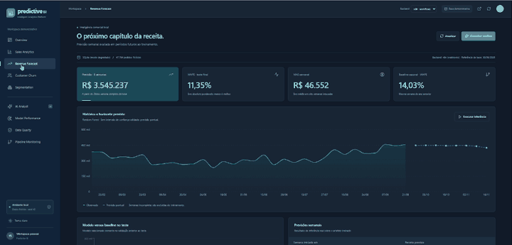

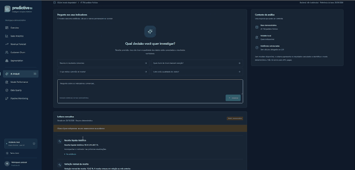

### Canvas completo

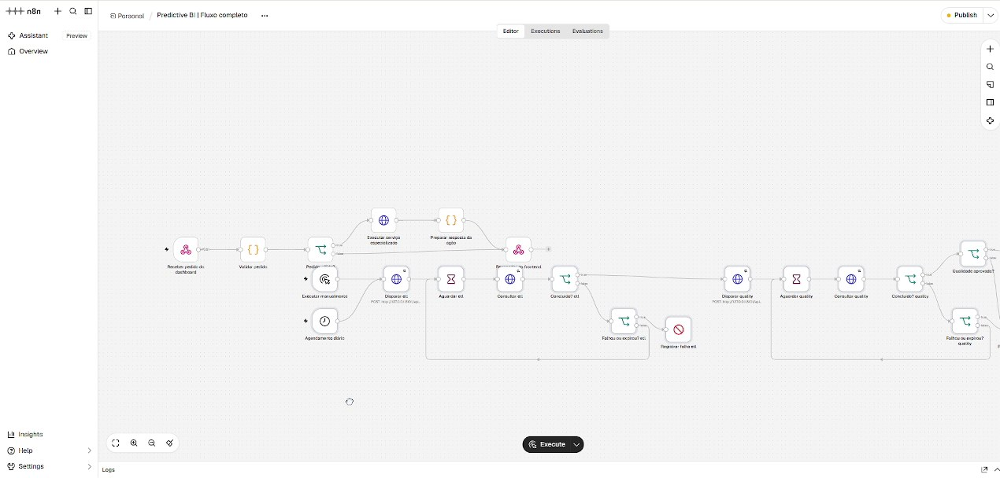

Os nove prints das páginas estão distribuídos pelo guia de análise acima. Instantes, recorte e hashes dos originais estão em [media-manifest.json](docs/media/media-manifest.json). O vídeo original foi preservado e não integra o repositório; apenas as seleções revisadas foram publicadas.

Para reproduzir exatamente esta seleção, com recorte e GIFs, use o gerador editorial versionado:

```powershell
.\.venv\Scripts\python.exe -m pip install opencv-python Pillow
.\.venv\Scripts\python.exe scripts/prepare_publication_media.py `
  --video 'C:\caminho\2026-10-29 14-50-45.mp4' `
  --logo 'C:\caminho\logo.png'
```

O utilitário [export_demo_media.py](scripts/export_demo_media.py) pode extrair outros instantes e cortes MP4 silenciosos. Os GIFs desta edição foram preparados com OpenCV/Pillow. OpenCV é uma dependência opcional de documentação:

```powershell
.\.venv\Scripts\python.exe -m pip install opencv-python
.\.venv\Scripts\python.exe scripts/export_demo_media.py `
  --video 'C:\caminho\gravacao.mp4' `
  --logo 'C:\caminho\logo.png' `
  --frames '10,38,44,56,62,76,84,103,108,110,114' `
  --clips '10:18,40:56,58:64,91:101'
```

O utilitário básico exporta quadros sem o recorte editorial desta galeria; revise barras do navegador e outros dados antes de publicar material adicional. Capturas de interface não substituem as evidências estatísticas das avaliações.

## Limites e próximos passos

### Limitações atuais

- Demonstração local sem autenticação/autorização própria na API comercial.
- Não expor bancos, worker ou webhooks à internet sem controles adicionais.
- Analytics n8n recebe as linhas da demonstração; volume grande exige paginação ou agregação SQL.
- Uma tarefa pesada por vez; sem fila distribuída ou cancelamento administrativo.
- Sem CDC de exclusões e sem dimensões lentamente mutáveis tipo 2.
- Sem intervalo probabilístico validado, drift ou reavaliação contínua.
- Segmentos e métricas limitados às hipóteses sintéticas.
- Sem campanhas, CRM, pagamentos ou decisões automáticas sobre pessoas.
- Tracking de experimento não equivale a um ciclo completo de promoção no Model Registry.
- Serviços de rede precisam de validação no ambiente de execução.

### Segurança e persistência

O Git exclui `.env`, variações de configuração local, virtualenv, runtime, dados, artefatos e bancos. Nunca inclua tokens em JSON de workflow ou frontend. A chave n8n deve permanecer estável e fora do repositório. O Compose expõe portas somente em loopback; outros contextos exigem revisão de exposição.

### Desenvolvimento e autoria

O primeiro ciclo implementou dados, ETL, modelos e interface. O segundo adicionou orquestração n8n com jobs assíncronos, idempotência e gate de qualidade. O terceiro colocou webhooks e regras Code no caminho normal do dashboard. Os geradores mantêm uma fonte versionável dos fluxos, além do canvas.

Projeto de **Vinicius de Souza Santos**, com assistência de IA na engenharia e documentação. As regras locais priorizam execução real, preservação de dados e resultados verificáveis.

### Evolução possível

Paginação/agregação no banco; migrações; autenticação; CI integrado PostgreSQL/n8n/Ollama; monitoramento de drift; intervalos de previsão; avaliação por coorte; SHAP do próprio modelo selecionado; promoção controlada de artefatos.

Esses itens são propostas de evolução, não funcionalidades declaradas como concluídas.

---

[ViniciusKanh/Predictive-BI-n8n-workflows](https://github.com/ViniciusKanh/Predictive-BI-n8n-workflows) · Dados sintéticos, cálculos inspecionáveis e automação local.
